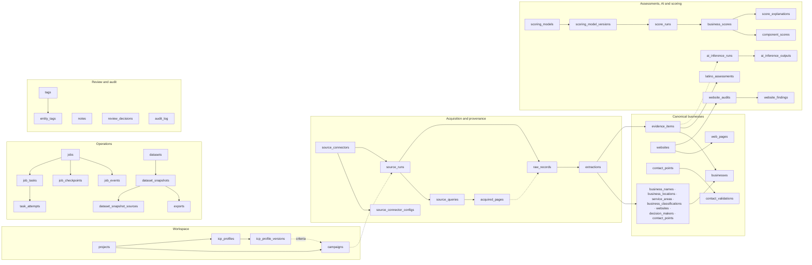
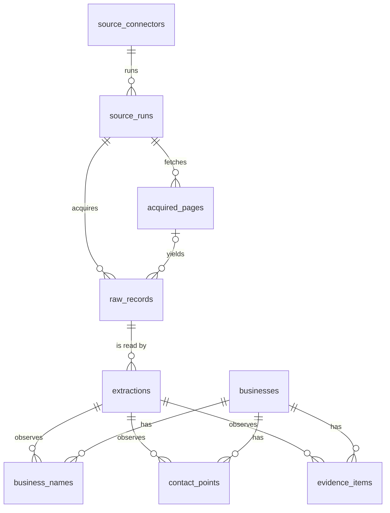

# Data model

The central model of Lead Intelligence: what is stored, where, how every value can be traced to
its source, and how the stores are kept safe. Delivered in phase 03; later phases fill the tables.

- Source of truth: [`research_engine/domain.py`](../services/research-engine/src/research_engine/domain.py)
  (Pydantic: enumerations, state machines, records, queries and pages).
- Schema: [`migrations/sqlite/0002_core_model.sql`](../services/research-engine/src/research_engine/migrations/sqlite/0002_core_model.sql)
  and [`migrations/duckdb/0002_business_snapshots.sql`](../services/research-engine/src/research_engine/migrations/duckdb/0002_business_snapshots.sql).
- Access: [`repository.py`](../services/research-engine/src/research_engine/repository.py) (SQLite) and
  [`datasets.py`](../services/research-engine/src/research_engine/datasets.py) (DuckDB + Parquet).
  Nothing else runs SQL against the model; the UI never does (D-004).

## 1. Where data lives

| Store                              | Holds                                                                                 | Why                                                     |
| ---------------------------------- | ------------------------------------------------------------------------------------- | ------------------------------------------------------- |
| SQLite `data/lead.sqlite3`         | Operational, mutable state: every record below, provenance, history, audit            | Transactions, constraints, foreign keys, triggers, FTS5 |
| DuckDB `data/analytics.duckdb`     | Analytical copies: rows of each dataset snapshot (`business_snapshot_rows`)           | Columnar scans and aggregations over large result sets  |
| Parquet `data/datasets/<ds>/<sn>/` | Durable, portable copy of each snapshot, partitioned by `region`, explicit schema     | Reproducible datasets that survive a DuckDB rebuild     |
| Files `data/artifacts/…`           | Acquired page bodies and other artefacts (from phase 05), referenced by relative path | Large blobs stay out of the database                    |
| `data/backups/`                    | Verified SQLite and DuckDB backups                                                    | Recovery (section 8)                                    |

Paths stored in the database are **relative to the data directory, with forward slashes** and no
`..` segment (`artifact_path`, `parquet_path`). A SQL `CHECK`, the Pydantic type and
`storage.data_path()` all refuse anything else, so a data directory can be moved or restored on
another machine without rewriting rows.

## 2. Logical diagram

The provenance chain, which every observed value follows:

## 3. Conventions

| Rule                  | How it is enforced                                                                                                                                               |
| --------------------- | ---------------------------------------------------------------------------------------------------------------------------------------------------------------- |
| Stable internal ids   | UUIDv7 text (RFC 9562, monotonic within the process). Names, domains and phones are never keys. `businesses.seq` exists only as the FTS row key.                 |
| UTC timestamps        | One format everywhere: `YYYY-MM-DDTHH:MM:SS.sssZ`. `CHECK (x IS strftime('%Y-%m-%dT%H:%M:%fZ', x))` rejects other forms and impossible dates.                    |
| No free-form states   | Each enumeration is a lookup table (`business_status`, `job_status`, …) referenced by a foreign key; values mirror the Python `StrEnum`.                         |
| Valid transitions     | `status_transitions` lists allowed changes; `BEFORE UPDATE OF <status>` triggers refuse the rest. `repository.change_status` checks first.                       |
| Raw next to normal    | Observations keep `*_raw` and `*_normalized` (or the structured parts) side by side; `raw_records.payload_json` is never modified.                               |
| JSON                  | `*_json` columns are `CHECK (json_valid(...))`; objects are written with sorted keys so equal payloads hash equally.                                             |
| Real constraints      | `STRICT` tables, `PRAGMA foreign_keys=ON`, `CHECK` ranges (confidence 0–1, scores 0–100, HTTP status, coordinates), partial unique indexes.                      |
| Recoverable deletions | `deleted_at` + `deleted_reason` (both or neither), audited. A trigger refuses `DELETE` of a live row; purge = soft delete first, then delete.                    |
| Immutable history     | `raw_records`, `extractions`, `audit_log`, `review_decisions` refuse `UPDATE` and `DELETE`; versions, validations, scores, events and snapshots refuse `UPDATE`. |

## 4. Provenance strategy

1. **Acquisition.** A `source_run` of a connector (with its effective configuration and version)
   fetches `acquired_pages` and stores `raw_records`: the payload exactly as received, its SHA-256,
   the acquisition method and moment, and a `source_url` or `external_id` (a `CHECK` requires one).
2. **Extraction.** Each pass of an extractor (name + version) over a raw record is one
   `extraction`. Re-running the same version reuses it (unique on raw record, extractor and
   version).
3. **Observation.** Every observed value (`business_names`, `business_locations`, `websites`,
   `contact_points`, `evidence_items`, …) references its extraction and carries its own
   `confidence`. So each value answers: source (connector), URL or identifier, acquisition moment,
   method, extractor and confidence (principle 1).
4. **Canonical business.** `businesses` holds the resolved entity and the display values chosen from
   its observations. Choosing changes the cache, never the observations.
5. **Inference is not fact.** AI output lives in `ai_inference_runs` / `ai_inference_outputs` with
   provider, model, digest, prompt and schema versions, input hash and the evidence it saw. An
   assessment (`latino_assessments`) cites evidence through `latino_assessment_evidence` and records
   its method and rules version; it never overwrites evidence.
6. **Scores** reference the exact `scoring_model_version`, store each component with weight and
   contribution, and keep explanations (`score_explanations`).

`repository.trace_lineage(conn, extraction_id)` walks a value back to its raw record, page, run and
connector; the business detail sent to the UI carries the same chain as a `Provenance` block per
value.

## 5. State machines

Staying on the same value is always allowed. Enumerations that are results rather than states
(`latino_status`: every assessment is a new row) have no machine.

| Enumeration                       | Allowed changes                                                                                                                                                                                                                                                                                                                                                                          |
| --------------------------------- | ---------------------------------------------------------------------------------------------------------------------------------------------------------------------------------------------------------------------------------------------------------------------------------------------------------------------------------------------------------------------------------------- |
| `business_status`                 | candidate → active, closed, merged · active → closed, merged · closed → active, merged · merged → active (unmerge; `merged_into_id` required while merged)                                                                                                                                                                                                                               |
| `source_run_status`, `job_status` | queued → running, cancelled · running → paused, succeeded, failed, cancelled · paused → running, cancelled · failed → queued (retry)                                                                                                                                                                                                                                                     |
| `evidence_status`                 | active → stale, contradicted, revoked · stale → active, revoked · contradicted → active, revoked · revoked is final                                                                                                                                                                                                                                                                      |
| `validation_status`               | any result → any other, except suppressed → observed only (a suppression is lifted explicitly)                                                                                                                                                                                                                                                                                           |
| `inference_status`                | queued → running, cancelled · running → succeeded, insufficient_evidence, invalid_output, failed, cancelled · failed, invalid_output → queued                                                                                                                                                                                                                                            |
| `lead_stage`                      | not_contacted → attempted, invalid_contact, not_interested · attempted → connected, invalid_contact, not_interested, lost · connected → qualified, not_interested, lost · qualified → meeting_booked, proposal_sent, not_interested, lost · meeting_booked → proposal_sent, won, lost · proposal_sent → won, lost · lost, invalid_contact, not_interested → not_contacted · won is final |
| `export_status`                   | pending → running, cancelled · running → succeeded, failed, cancelled · failed → pending                                                                                                                                                                                                                                                                                                 |

Other enumerations: `evidence_type`, `evidence_strength`, `latino_status`, `contact_type`,
`website_finding_severity`, `website_finding_result`, `source_kind`, `acquisition_method`,
`entity_type`, `audit_action`, `name_kind`, `service_area_kind`, `classification_kind`, `page_kind`,
`contact_origin`, `conversion_element_kind`, `assessment_method`, `evidence_role`,
`explanation_kind`, `event_level`, `export_format`. Values are listed in `domain.py`; adding one is a
forward migration that inserts a row.

## 6. Data dictionary

`?` marks a nullable column, `(enum)` a reference to a lookup table, `→ table` a foreign key. Every
table except the pure link tables also has `created_at`; mutable tables have `updated_at`;
soft-deletable ones have `deleted_at?` + `deleted_reason?`.

### Workspace

| Table                  | Purpose                                                      | Columns                                                                                                                                           |
| ---------------------- | ------------------------------------------------------------ | ------------------------------------------------------------------------------------------------------------------------------------------------- |
| `projects`             | Local workspace; `is_synthetic` flags test data only         | `id`, `name`, `description`?, `is_synthetic`                                                                                                      |
| `icp_profiles`         | Named ideal-customer profile                                 | `id`, `project_id` → projects, `name`, `description`?                                                                                             |
| `icp_profile_versions` | Immutable definition of a profile at one version             | `id`, `icp_profile_id` → icp_profiles, `version`, `definition_json`, `schema_version`, `created_by`                                               |
| `campaigns`            | What to look for; `criteria_json` follows a versioned schema | `id`, `project_id` → projects, `icp_profile_version_id`? → icp_profile_versions, `name`, `objective`?, `criteria_json`, `criteria_schema_version` |

### Sources and provenance

| Table                      | Purpose                                         | Columns                                                                                                                                                                                                                                                                                              |
| -------------------------- | ----------------------------------------------- | ---------------------------------------------------------------------------------------------------------------------------------------------------------------------------------------------------------------------------------------------------------------------------------------------------- |
| `source_connectors`        | A registered source adapter                     | `id`, `key` (unique), `name`, `kind` (source_kind), `connector_version`, `terms_url`?, `requires_credentials`, `enabled`                                                                                                                                                                             |
| `source_connector_configs` | Configuration and limits, global or per project | `id`, `connector_id` → source_connectors, `project_id`? → projects, `config_json`, `requests_per_minute`?, `daily_request_budget`?, `max_concurrency`?, `superseded_at`? (one current row per connector and project)                                                                                 |
| `source_runs`              | One execution of a connector                    | `id`, `project_id` → projects, `campaign_id`? → campaigns, `connector_id` → source_connectors, `connector_version`, `config_id`? → source_connector_configs, `job_id`? → jobs, `status` (source_run_status), `effective_config_json`, `started_at`?, `finished_at`?, `error_code`?, `error_message`? |
| `source_queries`           | Queries issued during a run, with the cursor    | `id`, `source_run_id` → source_runs, `query_json`, `cursor`?, `issued_at`, `result_count`?                                                                                                                                                                                                           |
| `acquired_pages`           | One fetch and where its body is stored          | `id`, `source_run_id` → source_runs, `source_query_id`? → source_queries, `url`, `final_url`?, `http_status`?, `content_type`?, `content_sha256`?, `byte_size`?, `artifact_path`? (relative), `fetched_at`                                                                                           |
| `raw_records`              | **Immutable** payload as acquired               | `id`, `source_run_id` → source_runs, `acquired_page_id`? → acquired_pages, `connector_id` → source_connectors, `method` (acquisition_method), `external_id`?, `source_url`?, `payload_json`, `payload_sha256`, `acquired_at`                                                                         |
| `extractions`              | **Immutable** extractor pass over a raw record  | `id`, `raw_record_id` → raw_records, `extractor`, `extractor_version`, `extracted_at`                                                                                                                                                                                                                |

### Canonical businesses and observations

| Table                      | Purpose                                                    | Columns                                                                                                                                                                                                                                                                                                                                                                                                                                                             |
| -------------------------- | ---------------------------------------------------------- | ------------------------------------------------------------------------------------------------------------------------------------------------------------------------------------------------------------------------------------------------------------------------------------------------------------------------------------------------------------------------------------------------------------------------------------------------------------------- |
| `businesses`               | Resolved business; display values cached from observations | `id`, `project_id` → projects, `display_name`, `name_sort_key`, `status` (business_status), `lead_stage` (lead_stage), `merged_into_id`? → businesses, `first_seen_at`, `last_seen_at`                                                                                                                                                                                                                                                                              |
| `business_names`           | Names as observed (legal, trade, DBA, alternate)           | `id`, `business_id` → businesses, `extraction_id` → extractions, `name_raw`, `name_normalized`, `name_kind` (name_kind), `is_primary` (one per business), `confidence`, `observed_at`                                                                                                                                                                                                                                                                               |
| `business_locations`       | Addresses and coordinates                                  | `id`, `business_id`, `extraction_id`, `address_raw`?, `street`?, `unit`?, `locality`?, `region`?, `postal_code`?, `country_code`?, `latitude`?, `longitude`?, `is_primary`, `confidence`, `observed_at`                                                                                                                                                                                                                                                             |
| `service_areas`            | Where the business works                                   | `id`, `business_id`, `extraction_id`, `area_raw`, `area_kind` (service_area_kind), `area_normalized`?, `radius_km`? (required for radius), `confidence`, `observed_at`                                                                                                                                                                                                                                                                                              |
| `business_classifications` | Categories and services as labelled, optionally mapped     | `id`, `business_id`, `extraction_id`, `kind` (classification_kind), `label_raw`, `taxonomy_key`?, `taxonomy_version`?, `is_primary`, `confidence`, `observed_at`                                                                                                                                                                                                                                                                                                    |
| `websites`                 | Sites and their domain                                     | `id`, `business_id`, `extraction_id`, `url_raw`, `url_normalized`, `domain` (lower case, indexed), `is_primary`, `confidence`, `observed_at`                                                                                                                                                                                                                                                                                                                        |
| `web_pages`                | Canonical pages of a site                                  | `id`, `website_id` → websites, `acquired_page_id`? → acquired_pages, `url_raw`, `url_normalized` (unique per site), `page_kind` (page_kind), `title`?, `observed_at`                                                                                                                                                                                                                                                                                                |
| `decision_makers`          | People only when published by a legitimate business source | `id`, `business_id`, `extraction_id`, `full_name_raw`, `full_name_normalized`, `role_raw`?, `role_normalized`?, `published_context`?, `confidence`, `observed_at`                                                                                                                                                                                                                                                                                                   |
| `contact_points`           | Phones, emails, contact/booking forms, social profiles     | `id`, `business_id`, `location_id`?, `decision_maker_id`?, `contact_type` (contact_type), `value_raw`, `value_normalized`?, `origin` (contact_origin: published, user_import, hypothesis), `platform`? (social only), `web_page_id`?, `role_or_department`?, `published_context`?, `is_primary`, `validation_status` (validation_status), `validated_at`?, `do_not_contact` + `suppression_reason`?, `confidence`, `extraction_id`, `first_seen_at`, `last_seen_at` |
| `contact_validations`      | **Immutable** history of validation results                | `id`, `contact_point_id` → contact_points, `status` (validation_status), `method`, `validator_version`, `detail_json`?, `validated_at`, `expires_at`?                                                                                                                                                                                                                                                                                                               |

### Evidence and assessments

| Table                        | Purpose                                                  | Columns                                                                                                                                                                                                                                                 |
| ---------------------------- | -------------------------------------------------------- | ------------------------------------------------------------------------------------------------------------------------------------------------------------------------------------------------------------------------------------------------------- |
| `evidence_items`             | Observed claim; only `status` may change                 | `id`, `business_id`, `evidence_type` (evidence_type), `claim`, `value_json`?, `strength` (evidence_strength), `status` (evidence_status), `confidence`, `extraction_id`, `web_page_id`?, `field_path`?, `snippet`? + `snippet_sha256`?, `observed_at`   |
| `latino_assessments`         | One evaluation, separate from evidence; newer supersedes | `id`, `business_id`, `status` (latino_status), `assessment_confidence`, `method` (assessment_method), `rules_version`, `inference_run_id`? → ai_inference_runs, `rationale`, `limitations`?, `assessed_at`, `superseded_at`? (one current per business) |
| `latino_assessment_evidence` | Evidence cited by an assessment                          | `assessment_id` → latino_assessments, `evidence_item_id` → evidence_items, `role` (evidence_role)                                                                                                                                                       |

### Website intelligence

| Table                  | Purpose                            | Columns                                                                                                                                                                                                                                        |
| ---------------------- | ---------------------------------- | ---------------------------------------------------------------------------------------------------------------------------------------------------------------------------------------------------------------------------------------------- |
| `website_audits`       | One audit of a site with a ruleset | `id`, `website_id` → websites, `ruleset_version`, `started_at`, `finished_at`?, `pages_analyzed`                                                                                                                                               |
| `website_technologies` | Detected technologies              | `id`, `audit_id` → website_audits, `name`, `category`?, `version`?, `confidence`, `evidence_item_id`?                                                                                                                                          |
| `conversion_elements`  | CTAs, forms, widgets               | `id`, `audit_id`, `web_page_id`?, `element_kind` (conversion_element_kind), `label`?, `confidence`, `evidence_item_id`?                                                                                                                        |
| `website_findings`     | Rule outcomes                      | `id`, `audit_id`, `rule_id`, `rule_version`, `category`, `result` (website_finding_result), `severity` (website_finding_severity), `observed_value`?, `expected_condition`?, `remediation`?, `confidence`, `web_page_id`?, `evidence_item_id`? |

### Local AI

| Table                   | Purpose                                        | Columns                                                                                                                                                                                                                                                            |
| ----------------------- | ---------------------------------------------- | ------------------------------------------------------------------------------------------------------------------------------------------------------------------------------------------------------------------------------------------------------------------ |
| `ai_inference_runs`     | One model call with everything to reproduce it | `id`, `task_type`, `task_version`, `provider`, `model`, `model_digest`?, `parameters_json`, `prompt_template_id`, `prompt_template_version`, `output_schema_version`, `input_sha256`, `status` (inference_status), `started_at`?, `finished_at`?, `error_message`? |
| `ai_inference_evidence` | Evidence given to the model                    | `inference_run_id` → ai_inference_runs, `evidence_item_id` → evidence_items                                                                                                                                                                                        |
| `ai_inference_outputs`  | **Immutable** raw and validated output         | `id`, `inference_run_id`, `business_id`?, `raw_output`, `validated_output_json`?, `confidence`?                                                                                                                                                                    |

### Scoring

| Table                    | Purpose                               | Columns                                                                                                                         |
| ------------------------ | ------------------------------------- | ------------------------------------------------------------------------------------------------------------------------------- |
| `scoring_models`         | Named scoring model                   | `id`, `key` (unique), `name`, `description`?                                                                                    |
| `scoring_model_versions` | **Immutable** definition per version  | `id`, `scoring_model_id` → scoring_models, `version`, `definition_json`, `is_heuristic`                                         |
| `score_runs`             | One scoring pass                      | `id`, `scoring_model_version_id`, `icp_profile_version_id`?, `dataset_snapshot_id`?, `job_id`?, `started_at`, `finished_at`?    |
| `business_scores`        | **Immutable** total per business, run | `id`, `score_run_id` → score_runs, `business_id` → businesses, `total_score`? (0–100), `confidence`?                            |
| `component_scores`       | Factor breakdown                      | `id`, `business_score_id` → business_scores, `component` (e.g. `ICP_MATCH`), `value`?, `weight`, `contribution`?, `confidence`? |
| `score_explanations`     | Ordered reasons, gates, penalties     | `id`, `business_score_id`, `component`?, `kind` (explanation_kind), `message`, `evidence_item_id`?, `sort_order`                |

### Jobs

| Table             | Purpose                                     | Columns                                                                                                                                                                                      |
| ----------------- | ------------------------------------------- | -------------------------------------------------------------------------------------------------------------------------------------------------------------------------------------------- |
| `jobs`            | Long-running work                           | `id`, `project_id`, `kind`, `status` (job_status), `priority`, `params_json`, `idempotency_key`? (unique), `progress_done`, `progress_total`?, `requested_at`, `started_at`?, `finished_at`? |
| `job_tasks`       | Idempotent unit of a job                    | `id`, `job_id` → jobs, `stage`, `task_key` (unique per job), `status` (job_status), `attempt_count`, `max_attempts`                                                                          |
| `task_attempts`   | One try of a task                           | `id`, `task_id` → job_tasks, `attempt`, `status` (job_status), `started_at`, `finished_at`?, `error_code`?, `error_message`?, `retryable`?                                                   |
| `job_checkpoints` | Resumable state                             | `id`, `job_id`, `task_id`?, `state_json`                                                                                                                                                     |
| `job_events`      | **Immutable** progress, warnings and errors | `id`, `job_id`, `task_id`?, `level` (event_level), `event`, `error_code`? (required for errors), `retryable`?, `detail_json`?                                                                |
| `job_metrics`     | Measurements                                | `id`, `job_id`, `task_id`?, `name`, `value`, `unit`?, `recorded_at`                                                                                                                          |

### Datasets and exports

| Table                      | Purpose                                                 | Columns                                                                                                                                                                                                                       |
| -------------------------- | ------------------------------------------------------- | ----------------------------------------------------------------------------------------------------------------------------------------------------------------------------------------------------------------------------- |
| `datasets`                 | Named, versioned dataset                                | `id`, `project_id`, `name` (unique live name per project), `description`?                                                                                                                                                     |
| `dataset_snapshots`        | **Immutable** version: row count, DuckDB table, Parquet | `id`, `dataset_id` → datasets, `version`, `row_count`, `duckdb_table`, `parquet_path` (relative), `schema_version`, `filters_json`                                                                                            |
| `dataset_snapshot_sources` | Lineage: exactly one source run, score run or parent    | `id`, `snapshot_id` → dataset_snapshots, `source_run_id`?, `score_run_id`?, `parent_snapshot_id`?                                                                                                                             |
| `exports`                  | An export and its manifest                              | `id`, `project_id`, `dataset_snapshot_id`?, `status` (export_status), `format` (export_format), `file_name`?, `row_count`?, `file_sha256`?, `manifest_json`?, `requested_at`, `started_at`?, `finished_at`?, `error_message`? |

### Review and audit

| Table              | Purpose                                                                    | Columns                                                                                                        |
| ------------------ | -------------------------------------------------------------------------- | -------------------------------------------------------------------------------------------------------------- |
| `tags`             | Project tags                                                               | `id`, `project_id`, `name` (unique live name per project)                                                      |
| `entity_tags`      | Tag on any entity (`entity_type` + UUID)                                   | `tag_id` → tags, `entity_type` (entity_type), `entity_id`                                                      |
| `notes`            | Analyst notes on any entity                                                | `id`, `project_id`, `entity_type` (entity_type), `entity_id`, `body`, `author`                                 |
| `review_decisions` | **Immutable** human decision with mandatory reason                         | `id`, `entity_type`, `entity_id`, `decision`, `previous_value`?, `new_value`?, `reason`, `actor`, `decided_at` |
| `audit_log`        | **Append-only** trail (status changes, soft delete, restore, purge, merge) | `id`, `occurred_at`, `actor`, `action` (audit_action), `entity_type`, `entity_id`, `detail_json`?              |

Polymorphic references (`entity_tags`, `notes`, `review_decisions`, `audit_log`) cannot be foreign
keys; `entity_type` is constrained and ids are globally unique UUIDs, so the pair always resolves.

### DuckDB

`business_snapshot_rows (snapshot_id, business_id, project_id, display_name, status, lead_stage,
locality, region, postal_code, primary_domain, primary_phone, primary_category, source_count,
evidence_count, first_seen_at, last_seen_at)`, primary key `(snapshot_id, business_id)`, timestamps
as UTC `TIMESTAMP`. The same explicit schema (`datasets.BUSINESS_SNAPSHOT_SCHEMA`) types the JSON
load and the Parquet copy; a test compares the three.

## 7. Queries, search and pagination

- **Keyset pagination.** Lists order by a key plus `id` and return an opaque cursor (URL-safe
  base64 of `[sort, last key, last id]`) instead of offsets. A cursor from another sort is refused.
  Pages stay stable while rows are inserted, and no query loads the whole table. `total` counts
  every match of the filters.
- **Full-text search.** `business_search` (FTS5, `unicode61 remove_diacritics 2`) indexes the display
  name, every observed name and the places of each business; triggers keep it in sync, its row key
  is `businesses.seq` (stable across `VACUUM`). User input is reduced to words and each word becomes
  a quoted prefix term, so FTS syntax never reaches the index.
- Measured on 20,000 synthetic businesses (180,000 observation rows): first page 20 ms, page 51
  18 ms, search 29 ms, last-seen order 15 ms, detail 2 ms; ingestion ~800 businesses/s with every
  constraint and the search index active (`test_performance_on_a_synthetic_dataset`).

## 8. Backup and recovery

| Situation                          | Behaviour                                                                                                                                                                                                                                                      |
| ---------------------------------- | -------------------------------------------------------------------------------------------------------------------------------------------------------------------------------------------------------------------------------------------------------------- |
| Pending migrations on a used store | A verified backup is written first (`backups/lead-<utc>-before-vNNNN.sqlite3`, `analytics-…duckdb`). The newest 10 per engine are kept.                                                                                                                        |
| A migration fails                  | Its transaction rolls back; the store stays on the previous version and the System screen shows the error. The backup remains.                                                                                                                                 |
| SQLite damaged                     | Detected by `quick_check` on every health check. The file (and `-wal`/`-shm`) is **quarantined** as `lead.sqlite3.corrupt-<utc>` and the newest backup that passes `integrity_check` + `foreign_key_check` is restored. State: degraded, with both file names. |
| SQLite damaged, no usable backup   | Nothing is touched; the store reports an error with the runbook in [operations.md](operations.md).                                                                                                                                                             |
| DuckDB damaged                     | Quarantined; newest backup restored, otherwise an empty store is created (its rows are derived and snapshots stay available as Parquet). State: degraded.                                                                                                      |

Backups use SQLite's online backup API and DuckDB's `COPY FROM DATABASE`, so the app does not need
to stop. Nothing in recovery deletes data.

## 9. Contracts and versions

| Version                 | Covers                                             | Where                        | Rule                                                                                                |
| ----------------------- | -------------------------------------------------- | ---------------------------- | --------------------------------------------------------------------------------------------------- |
| `protocol_version`      | JSON Lines envelope                                | `contracts.py`               | exact match between core and worker                                                                 |
| `data_contract_version` | shapes of records, enumerations, queries and pages | `contracts.py` + `domain.py` | reported in the worker handshake; the core refuses another version; also stored in `store_metadata` |
| schema version          | database structure                                 | migrations                   | forward-only, checksummed; a store from a newer build is refused                                    |

Pydantic is the single source of truth (D-003). `pnpm contracts` exports the JSON Schema, the
TypeScript types and golden fixtures; data fixtures are produced by the real repository queries on a
temporary store seeded with synthetic data. Automated checks close the loop:

- **SQL ↔ Pydantic:** `test_model.py` compares every table column by column (name, type,
  nullability), every enum lookup table, every foreign key to a lookup table and the transition table.
- **Pydantic ↔ JSON ↔ Rust:** `src-tauri/tests/contracts.rs` round-trips every fixture through the
  Rust mirror (`src-tauri/src/data.rs`) and checks that tampered payloads are refused.
- **JSON ↔ TypeScript:** generated types, plus `apps/desktop/src/lib/contracts.test.ts`, which fails
  to compile if a type gains or loses a field and fails at runtime if fixtures disagree.

Additive changes (a new nullable field, a new record or enumeration value) ship with a forward
migration and keep `data_contract_version`; removing or renaming anything bumps it.

## 10. Test data

[`testdata.py`](../services/research-engine/src/research_engine/testdata.py) builds **synthetic**
records for tests, fixtures and the development-only seed: names start with "Synthetic", domains use
`.example`, phones use the fictional 555-01xx range, addresses are on "Example Ave", payloads carry
`"test_data": true`, the project is flagged `is_synthetic`, and no person is represented. The UI
labels every synthetic row and detail as test data. The seed exists only in development builds:
the core refuses it in release builds and the worker refuses it unless `LEAD_DEV_TOOLS=1`.
