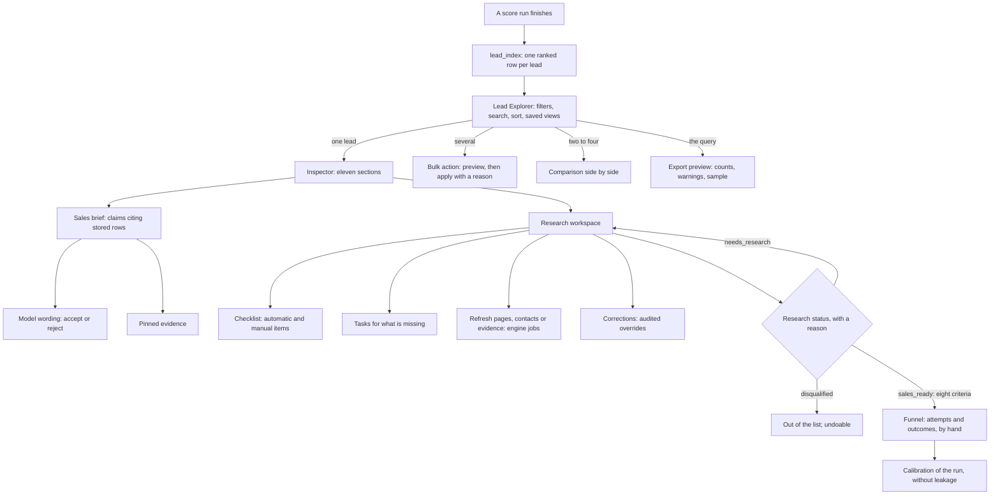

# Lead Explorer and research

Phase 12 is where an analyst works over what the engines stored: find leads, compare them, research
them, decide, and record what happened when they were worked. It computes no new fact and contacts
no one.

- Worker: `research_engine/leads/`: `index.py` (the projection of score runs), `explorer.py`
  (queries, export preview, comparison), `views.py` (saved views), `research.py` (workspace,
  checklists, actions, bulk actions, timeline), `brief.py` (sales briefs) and `common.py`.
- Migration: `0011_lead_research.sql` ([data-model.md](data-model.md)).
- Messages: `leads.catalog`, `leads.explore`, `leads.export_preview`, `leads.bulk`, `leads.compare`,
  `views.list`, `views.save`, `views.change`, `research.get`, `research.act`, `research.timeline`,
  `research.evidence`, `research.checklists`, `research.save_checklist`,
  `research.change_checklist` and `research.brief`, mirrored and validated in Rust.
- Interface: `apps/desktop/src/features/leads/` (explorer, filters, views, bulk actions, export
  preview, comparison, research, brief, timeline) and `features/businesses/` (the inspector's eleven
  sections and the full view).
- Decisions D-076 to D-082 in [decisions.md](decisions.md).

## 1. Analyst flow

1. **A run becomes rows.** A finished score run is projected into `lead_index`, one ranked row per
   lead.
2. **Narrow.** In the Lead Explorer the analyst narrows the run with filters, a quick search and
   sort keys, and keeps useful views. The selection is kept by id while they page, sort or open a
   lead.
3. **Look.** Opening a lead shows the inspector: what is known, why it scored as it did, its brief,
   its contacts and suppressions, its timeline and every piece of evidence behind a claim.
4. **Research.** The workspace lists the checklist and the tasks. The analyst asks for a refresh when
   data is old or missing, corrects a value with a reason, and pins what matters.
5. **Decide.** `needs_research` and `disqualified` need a reason; `sales_ready` also needs every
   criterion of section 2. Any change can be undone as a new decision.
6. **Record.** The lead is worked outside the app. The analyst records attempts and outcomes by
   hand, and a later calibration of the run reads them. Nothing here sends a message.

## 2. Sales-ready: the exact criteria

`research.act` refuses `sales_ready` unless every criterion below holds at the moment of the change;
the workspace lists each one, in this order, with its detail. Sales-ready is never a bulk action, and
an undo that returns to it checks the criteria again.

| #   | Criterion                    | Holds when                                                                                                                                                                                                  | Detail when it fails                                                   |
| --- | ---------------------------- | ----------------------------------------------------------------------------------------------------------------------------------------------------------------------------------------------------------- | ---------------------------------------------------------------------- |
| 1   | `not_suppressed`             | The business has no live business-level entry on the do-not-contact list (phase 09)                                                                                                                         | "On the do-not-contact list: <reason>"                                 |
| 2   | `active_business`            | Its status is neither `closed` nor `merged`                                                                                                                                                                 | "Business status: <status>"                                            |
| 3   | `scored_recently`            | The newest finished score run scored it on facts read at most 90 days ago                                                                                                                                   | "Not scored by a finished run yet" or "Facts read N days ago: score …" |
| 4   | `qualifying_tier`            | That score's tier is `priority` or `review`                                                                                                                                                                 | "Tier <tier>, total <total>"                                           |
| 5   | `verified_opportunity`       | That scorecard recommends an offer: an observed problem the offer solves                                                                                                                                    | "No observed problem that an offer solves"                             |
| 6   | `usable_contact`             | Not suppressed, and at least one published channel phase 09 counts as reachable: a validation status that counts toward contactability, not `stale`, not on the do-not-contact list, not a fictional number | "No usable published channel"                                          |
| 7   | `contact_conflicts_resolved` | No phone or email conflict of kind `values_disagree` is left, unless a person chose the value to show                                                                                                       | "Records disagree on the phone and email: choose the value to show"    |
| 8   | `checklist_complete`         | Every required item of the checklist matched to the lead is done (section 5)                                                                                                                                | "N of M required items of '<checklist>' done"                          |

## 3. The Lead Explorer

### The index

`lead_index` holds one row per business per score run: the columns the explorer filters and sorts
on, projected from the facts and scorecard the run stored. A run writes its rows with its scores and
ranks them when it finishes (tier, total, confidence, business id: D-072). A run scored before phase
12 is projected the first time it is read, and a soft-deleted business's rows are dropped by trigger.
The index is a snapshot of the run. What changes after scoring is read live: the lead stage, the
research status and assignee, tags, the do-not-contact list and the age of the facts.

### Fields and operators

| Group                        | Fields                                                                                                                                                                                                                                                                                                                                                                                               |
| ---------------------------- | ---------------------------------------------------------------------------------------------------------------------------------------------------------------------------------------------------------------------------------------------------------------------------------------------------------------------------------------------------------------------------------------------------- |
| Scored (snapshot of the run) | business, city, state, vertical, website, tier, rank, lead score, confidence, data coverage, ICP match, opportunity, digital gap, business health (estimate), buying capacity (estimate), contactability, commercial intent, data confidence, Latino evidence and its confidence, main channel and its status, usable channels, problem (set), top problem, offer, website audit, conflicts, partial |
| Live                         | lead stage, research status, assignee, tag (set), do not contact, stale, facts age in days                                                                                                                                                                                                                                                                                                           |

| Type   | Operators                                                                                   |
| ------ | ------------------------------------------------------------------------------------------- |
| text   | is, is not, contains, starts with, is any of, is none of, is empty, is not empty (any case) |
| number | is, is not, below, at most, above, at least, is empty, is not empty                         |
| enum   | is, is not, is any of, is none of, is empty, is not empty (values from the catalog)         |
| flag   | is yes, is no                                                                               |
| set    | has, does not have                                                                          |

A condition joins others in a group with **all of** (`and`) or **any of** (`or`); a group may be
negated and may hold groups. A test on a missing value is false, `is not` and `is none of` keep
missing values, and a negated group keeps the leads it did not match, missing values included. The
quick search is the full-text index of phase 03 over the names and places of a business and of every
record merged into it. Without sort keys, leads keep the run's rank order; with keys, missing values
come last and the business id breaks the remaining ties.

| Limit                       | Value                                                 |
| --------------------------- | ----------------------------------------------------- |
| Filter depth                | 3 levels                                              |
| Conditions in one tree      | 40                                                    |
| Children of one group       | 20                                                    |
| Values of `in` and `not in` | 50                                                    |
| Sort keys                   | 4                                                     |
| Rows per window             | 500 (the grid reads 100)                              |
| Offset                      | 5 000 000                                             |
| Bulk action by id           | 1 000 leads                                           |
| Bulk action over a query    | 5 000 leads, applied only while that many still match |
| Comparison                  | 2 to 4 leads of one run                               |
| Stale                       | facts read more than 90 days ago                      |
| Export preview sample       | 1 to 50 rows                                          |

### Saved views

A view keeps filters, search, sort keys and columns (visible, pinned, width). Views are named (one
live view per name), and each saved change is an immutable version; saving an unchanged definition
makes nothing. Archiving and restoring need a reason and are audited. A view stored with an older
schema is upgraded when read, never rewritten:

| Schema 1 held                 | Schema 2 reads it as                                                   |
| ----------------------------- | ---------------------------------------------------------------------- |
| Flat conditions, all required | One `and` group with those conditions                                  |
| One optional sort key         | That key                                                               |
| The list of visible columns   | Those columns visible (rank and name pinned), every other field hidden |

The next save of an upgraded view appends a version in schema 2, and a schema newer than the build is
refused. The layout on screen (filters, search, sort, columns and the active view) is kept in the
local preferences and restored after a restart. Unknown columns are dropped, new fields appended, and
a layout of an older schema falls back to the default view.

### Bulk actions

| Action                 | Applies                              | Skipped as                                         |
| ---------------------- | ------------------------------------ | -------------------------------------------------- |
| Add or remove a tag    | The tag on the business              | `unchanged` when it already has it or has not      |
| Assign or unassign     | The assignee                         | `unchanged`                                        |
| Mark as needs research | The research status, with the reason | `unchanged`; `suppressed` for do-not-contact leads |
| Disqualify             | The research status, with the reason | `unchanged`                                        |

A bulk action works on leads selected by id, or on every lead a query matches. It is previewed first:
how many are targeted, how many would change and why the others would not. Applying needs a reason
and writes one audited change per lead, all sharing a batch id. Over a query, the apply names the
count its preview showed and is refused when the leads matching now are not that many. Leads not
found are skipped as `not_found`.

### Export preview

What an export of the query would hold, before anything is written (exports arrive in phase 13):

- **Counts:** matching, left out as do-not-contact (unless included on purpose) and exported.
- **A real sample:** up to 50 rows, in the chosen columns.
- **Warnings:** `suppressed_included`, `stale_rows`, `partial_rows`, `synthetic_rows`,
  `no_finished_run`, and always `hypotheses_never_exported`: addresses guessed from a pattern never
  leave the store (phase 09).

### Comparison

Two to four leads of one run side by side: every index field, plus the top reasons and the risks of
each scorecard. A lead the run did not score is named as missing.

## 4. The business inspector

The side panel and the full view (`/businesses/<id>`) show the same eleven sections. In the side
panel a folded section reads nothing until it opens; the full view opens all of them, and one read of
the sales brief feeds sections 3, 8, 9 and 10. Opening a lead in the explorer reads the next lead's
business ahead, once.

| #   | Section                   | What it shows                                                                                                                                                     | Open in the panel |
| --- | ------------------------- | ----------------------------------------------------------------------------------------------------------------------------------------------------------------- | ----------------- |
| 1   | Summary and sources       | Every observed value with its provenance, the value shown and its conflicts, the records merged, merge history, links to the sources                              | yes               |
| 2   | Scorecard                 | The scorecard of phase 11 with its versions; review; attempts and outcomes                                                                                        | yes               |
| 3   | Why this lead             | The brief's snapshot, ICP match, verified opportunity, contact route, decision maker, hooks and last verification, facts apart from inferences; the model wording | no                |
| 4   | Latino evidence           | Status, tracks, evidence and review (phase 07)                                                                                                                    | yes               |
| 5   | Website                   | The newest audit of the business's site: findings with their evidence, snapshot, history (phase 08)                                                               | no                |
| 6   | Contacts and suppressions | Channels with their exact status, people published with their role, hypotheses, the do-not-contact list (phase 09)                                                | yes               |
| 7   | Timeline                  | Section 7 below                                                                                                                                                   | no                |
| 8   | Evidence                  | The brief's evidence claims and the observed evidence; any cited row opens in place                                                                               | yes               |
| 9   | Conflicts and unknowns    | Fields whose records disagree, and the brief's risks and unknowns                                                                                                 | no                |
| 10  | Offer and reasoning       | The brief's recommended offer and why                                                                                                                             | no                |
| 11  | Notes and review          | The research workspace (section 5) and the local model's analyses with their reviews (phase 10)                                                                   | no                |

A cited row (a business record, evidence item, website audit, finding or technology, contact channel,
decision maker, Latino assessment, model inference or score run) is looked up only within its
business: its excerpt, status, confidence, time, source and provenance. From there it can be pinned.

## 5. Research workspace

| Element     | Rule                                                                                                                                                                                                                                                                          |
| ----------- | ----------------------------------------------------------------------------------------------------------------------------------------------------------------------------------------------------------------------------------------------------------------------------- |
| Status      | Current value in `lead_research`; every change is a `research_status` decision with its reason. Sales-ready needs section 2. Undo sets the previous status again as a new decision ("Undo: <reason>"). The history lists the last 50 decisions                                |
| Assignee    | `research_assignee` decisions                                                                                                                                                                                                                                                 |
| Tags        | Project tags on the business; each change audited                                                                                                                                                                                                                             |
| Checklist   | Versioned. A lead gets the checklist that names a campaign one of its records came from, else one whose categories match the lead's, else the default. Automatic items read the stored facts; a person ticks manual items (immutable checks; unticking needs a reason)        |
| Tasks       | Missing data, checklist, refresh or custom; one open task per key. Syncing opens a task for each weighted unknown of the score (up to 10) and each required item left undone. Done, dismissed with a reason, reopened; never deleted                                          |
| Pins        | Any cited row; a pin says when its row is no longer available; unpinned once, with a reason                                                                                                                                                                                   |
| Notes       | Notes on the business; deleted with a reason, kept in history                                                                                                                                                                                                                 |
| Corrections | Name, address, website, phone, email or category: an observation from the `analyst.corrections` connector, whose raw record carries the reason, chosen as the value shown. The source rows are untouched; choosing another value undoes it                                    |
| Refresh     | Pages: a crawl of up to five known website addresses. Contacts: a contact check of the project, without mail DNS lookups. Evidence: a Latino evaluation of the project. Each opens or reuses the task `refresh:<scope>` and records its job ids. Nothing reaches the business |

The default "Sales-ready checklist" is created the first time a workspace is read:

| Item                         | Kind      | Required |
| ---------------------------- | --------- | -------- |
| `scored_recently`            | automatic | yes      |
| `qualifying_tier`            | automatic | yes      |
| `verified_opportunity`       | automatic | yes      |
| `usable_contact`             | automatic | yes      |
| `contact_conflicts_resolved` | automatic | yes      |
| `decision_maker_published`   | automatic | no       |
| `website_audited`            | automatic | no       |
| `latino_evaluated`           | automatic | no       |
| `offer_fit_confirmed`        | manual    | yes      |
| `contact_route_reviewed`     | manual    | yes      |

## 6. Sales brief

| Section              | Holds                                                                       | Empty when                    |
| -------------------- | --------------------------------------------------------------------------- | ----------------------------- |
| Business snapshot    | Name, category and place; the acquired records; the website                 | `no_data`                     |
| Why it matches       | ICP criteria that passed with evidence                                      | `no_icp_criterion_passed`     |
| Verified opportunity | Observed problems, and their probable impact (inference)                    | `no_observed_problem`         |
| Evidence             | Pinned evidence, key findings and contact checks                            | `no_evidence`                 |
| Recommended offer    | The offer and why it fits (inference)                                       | `no_offer_recommended`        |
| Contact route        | The best usable channel with its status and freshness; none when suppressed | `no_usable_contact`           |
| Decision maker       | A person the business published, with the role                              | `no_decision_maker_published` |
| Conversation hooks   | A neutral question for each observed problem (inference)                    | `no_hook`                     |
| Risks and unknowns   | Risks and the score's missing data                                          | `no_known_risk`               |
| Last verified        | When the facts were read, the site audited and the channels checked         | `never_verified`              |

A section not scored yet says `not_scored`. Each claim (B1, B2…, at most six per section) cites
between one and eight stored rows; nothing without a row is written. Hooks are questions or offers to
look, never a verdict.

**Model wording.** The local model may reword a brief (`sales_brief`, phase 10, quality profile):

- **Input:** only the brief's claims, at most 40, 500 characters each and 8 000 in all. A lead on
  the do-not-contact list is never worded.
- **Answer:** at most ten sections of four sentences (300 characters each). Every sentence cites
  claim ids.
- **Rejected answers:** kept with their errors, never shown. An answer is rejected when it:
  - cites an id it was not given (`unknown_evidence_id`: a hallucinated reference);
  - repeats a section;
  - writes a number no cited claim contains (`number_not_in_evidence`);
  - uses accusatory language (`accusatory_language`, from amateurish, awful, clueless, disgraceful,
    dumb, embarrassing, fraud, garbage, horrible, idiot, incompetent, lazy, negligent, pathetic,
    scam, shady, sloppy, stupid, terrible, trash, ugly, unprofessional, useless, worthless);
  - calls an empty answer valid, or gives content while saying the evidence is insufficient.
- **On read:** the newest valid, not rejected answer shows only the sentences whose every cited
  claim is still in the brief, matched by section and text. The others are dropped and counted.
- **Review:** a person accepts or rejects the wording with a reason; the answer itself is never
  deleted.
- **Scope:** wording is asked for lead by lead. A request for `sales_brief` must name its
  businesses, and the analysis of a whole project leaves it out.

## 7. Timeline

Newest first, 50 entries a page, filterable by kind; every entry links to what it rests on.

| Kind     | Entries                                                                                                                  | Links               |
| -------- | ------------------------------------------------------------------------------------------------------------------------ | ------------------- |
| Source   | Each raw record a name, place, website, contact or evidence item of the business (or a merged record) was extracted from | job, source         |
| Change   | Audit log entries of the business and its records                                                                        | —                   |
| Analysis | Scores, Latino assessments and local model inferences                                                                    | score run, row, job |
| Review   | Review decisions on the business: chosen values, score reviews, research status and assignee                             | —                   |
| Research | Tasks, pins, notes (a deleted note keeps no body) and checklist ticks                                                    | row                 |
| Outcome  | Attempts (the stage kept) and stage changes                                                                              | score run           |

## 8. Funnel

The scorecard panel records by hand, and nothing sends a message:

| Record  | Needs                                           | Optional                                    | Stage            |
| ------- | ----------------------------------------------- | ------------------------------------------- | ---------------- |
| Attempt | Reason, channel, result                         | Contact quality, value with currency, notes | kept             |
| Outcome | Reason, the new stage (a lost lead: its reason) | Channel, result, quality, value, notes      | moves (phase 11) |
| Review  | Reason                                          | —                                           | —                |

Results: no answer, left a message, reached, replied, bounced, wrong contact, call back later,
meeting set, proposal sent, won, lost. Contact quality: decision maker, gatekeeper, wrong person,
unreachable, unknown. A value is a non-negative amount with a three-letter currency. Every row is
immutable in `lead_outcomes`. Calibration (phase 11) keeps labelling a run's businesses by stages
recorded after its facts were read: an attempt changes no label, and no run's facts or scores are
rewritten.

## 9. Interface

- **Grid.**
  - Reads windows of 100 rows as it scrolls and keeps at most 12; only the rows in view exist in the
    page.
  - The first window counts the leads. The answer to a superseded query is dropped: a request to
    the worker cannot be cancelled, so it is ignored instead.
  - The scroll area stops at 8 000 000 pixels and maps onto the rows proportionally beyond that, so
    the last of a million rows stays reachable.
- **Accessibility.** The grid is a `grid` with row and column counts and indexes and multiple
  selection. It keeps the focus and points at the active row: ↑ ↓, Page Up and Page Down, Home and End
  move, Space selects, Enter opens. A header click sorts; Shift adds a key.
- **Selection.** By business id, kept while paging, sorting, filtering or leaving the screen during a
  session. "Select all N matching leads" (up to 5 000) selects the query itself and ends when its
  filters or search change.
- **States.** Loading; counting; earlier results shown while a new query runs; windows that could not
  be read, with a retry; offline or failed, with retry, back to the newest run and reset of the
  layout; and honest empty states: no finished run yet, or no lead matching the filters. Do-not-contact,
  stale, partial, conflicting and test leads are labelled in words, and estimates say so.
- **Deep links.**

| Link                                | Opens                                                        | Linked from                                                    |
| ----------------------------------- | ------------------------------------------------------------ | -------------------------------------------------------------- |
| `/businesses/<id>`                  | The business in full                                         | The inspector                                                  |
| `/lead-explorer?run=<score run id>` | The explorer on that run, a score version                    | Timeline, Jobs (scoring runs)                                  |
| `/jobs?job=<job id>`                | Jobs with that job marked, or a notice when it is not listed | Timeline                                                       |
| `/sources?source=<connector key>`   | Sources with that source marked, or a notice                 | Timeline, the inspector's summary                              |
| `/datasets?dataset=<dataset id>`    | Datasets with that dataset marked                            | Nothing yet: a business records no dataset snapshot (phase 13) |

## 10. Limits

| Limit                                                                                            | Consequence                                                            |
| ------------------------------------------------------------------------------------------------ | ---------------------------------------------------------------------- |
| The index is the run's snapshot: name, place, scores and channel are as they were scored         | Score again to see new facts in these columns; live fields are current |
| A bulk action over a query takes at most 5 000 leads, and 1 000 by id                            | Narrow the query first                                                 |
| A refresh of contacts or evidence covers the lead's whole project: those engines run per project | Longer jobs on large projects                                          |
| Brief phrases, hooks and the model's wording are in English                                      | Translate before use                                                   |
| The export preview writes nothing                                                                | Exports arrive in phase 13                                             |
| The selection is kept for the session only, and the layout on this machine only                  | A restart restores the layout, not the selection                       |
| Actors are local names; there is no multi-user locking                                           | One analyst per store                                                  |
| Each run's index costs about 930 bytes a lead on disk, and writing a million rows took 5 minutes | Section 11                                                             |

## 11. Performance

Measured with `scripts/profile_lead_explorer.py` on the development machine (Windows 11) over the
synthetic workspace plus one million cloned index rows in its newest run (1 000 038 leads). Times
are one call each through `leads.explorer`, as the worker runs it; memory is the Python peak of the
call (`tracemalloc`), which excludes SQLite's own page cache (at most 64 MiB, plus the 256 MiB
memory map).

| Call                                                                | Time     | Python peak | Result                           |
| ------------------------------------------------------------------- | -------- | ----------- | -------------------------------- |
| First window in rank order, with the total (first call of the run)  | 291 ms   | 0.72 MiB    | 100 rows of 1 000 038            |
| First window in rank order, with the total                          | 178 ms   | 0.70 MiB    | 100 rows                         |
| Window at offset 999 900 in rank order                              | 117 ms   | 0.70 MiB    | 100 rows                         |
| AND/OR filters and two sort keys, first window with the total       | 575 ms   | 0.70 MiB    | 100 rows of 333 333              |
| The same, next window                                               | 313 ms   | 0.70 MiB    | 100 rows                         |
| The same, at offset 100 000                                         | 405 ms   | 0.70 MiB    | 100 rows                         |
| A sort no index holds (contactability), first window with the total | 622 ms   | 0.70 MiB    | 100 rows                         |
| The same, at offset 500 000                                         | 1 702 ms | 0.70 MiB    | 100 rows                         |
| Lead score descending at offset 500 000                             | 202 ms   | 0.70 MiB    | 100 rows                         |
| A selective name filter, with the total                             | 921 ms   | 0.70 MiB    | 100 rows of 100                  |
| Off the do-not-contact list, with the total                         | 932 ms   | 0.70 MiB    | 100 rows of 1 000 038            |
| A tag, with the total                                               | 921 ms   | 0.02 MiB    | 1 row of 1                       |
| Export preview: counts, warnings and a 50-row sample                | 655 ms   | 0.36 MiB    | 333 333 matching                 |
| Bulk action over the whole run (refused)                            | 152 ms   | 0.00 MiB    | 1 000 038 match: narrow to 5 000 |
| Bulk action over a narrow query (name prefix)                       | 956 ms   | 0.01 MiB    | 10 leads resolved                |

- **Conditions the index's leading columns cannot narrow cost the most.** A name, a tag or the
  do-not-contact list reads every entry of the run in `lead_index_scan`, for the count and for the
  window: about 0.9 s at a million leads. A tier filter narrows the scan (0.58 s with the count), and
  a later window, which skips the count, takes 0.3 to 0.4 s.
- **The grid never loads the run.** Every window holds under 1 MiB of Python objects whatever its
  offset; the UI keeps at most 12 windows of 100 rows.
- **Writing the index.** Cloning 100 000 rows took 3.1 s and a million 5 minutes: past the page cache,
  inserts into five indexes keyed by random ids hit the disk. A real run writes its rows as it
  scores, in batches of 200 businesses.

Size on disk, measured with `dbstat` over 100 000 cloned rows (it grows linearly):

| Object                   | Bytes per lead per run |
| ------------------------ | ---------------------- |
| `lead_index` (the table) | 316                    |
| `lead_index_scan`        | 279                    |
| `lead_index_by_name`     | 127                    |
| `lead_index_by_total`    | 104                    |
| `lead_index_by_rank`     | 54                     |
| `lead_index_by_business` | 52                     |
| **Total**                | **932**                |

With a million index rows the profiling store's files held 1 086 MiB.
